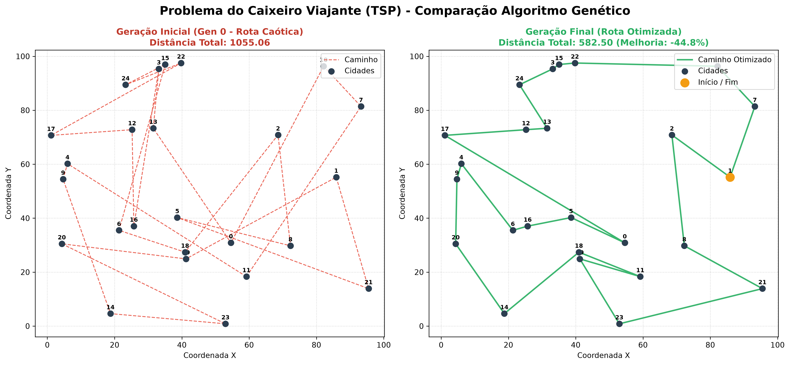
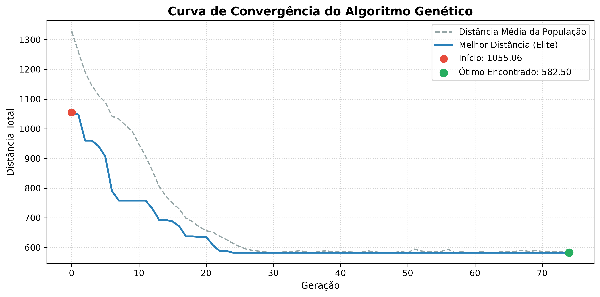
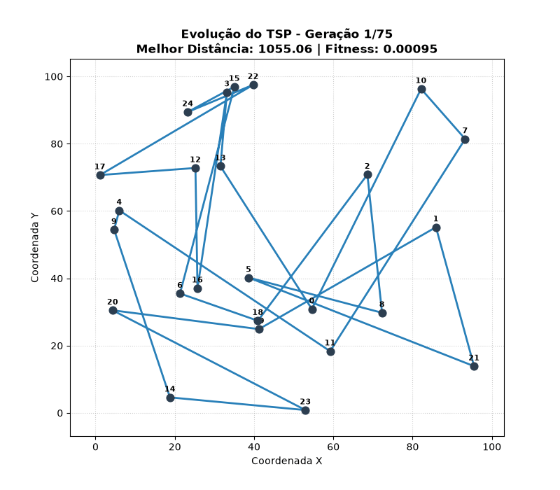

# Algoritmo Genetico para o Problema do Caixeiro Viajante (TSP)

> **Disciplina:** Inteligencia Artificial  
> **Tema:** Otimizacao Combinatoria do Problema do Caixeiro Viajante (Traveling Salesperson Problem - TSP)  
> **Integrantes da Dupla:** Rhyan Nascimento e Vitória Leal  
> **Video da Apresentacao (Max. 5 minutos):** [apresentacao.mp4](./apresentacao.mp4)  
> **Repositorio GitHub:** [https://github.com/drgeralt/ia-tsp-genetic-algorithm](https://github.com/drgeralt/ia-tsp-genetic-algorithm)

---

## Sumario

1. [Descricao do Problema](#1-descricao-do-problema)
2. [Desenvolvimento: Modelagem Genetica Aplicada](#2-desenvolvimento-modelagem-genetica-aplicada)
   - [2.1 Codificacao (Alfabeto Genetico)](#21-codificacao-alfabeto-genetico)
   - [2.2 Cromossomos (Genes por Individuo)](#22-cromossomos-genes-por-individuo)
   - [2.3 Funcao de Avaliacao (Fitness)](#23-funcao-de-avaliacao-fitness)
   - [2.4 Operador de Selecao](#24-operador-de-selecao)
   - [2.5 Operador de Cruzamento (Order Crossover - OX)](#25-operador-de-cruzamento-order-crossover---ox)
   - [2.6 Operador de Mutacao (Swap Mutation)](#26-operador-de-mutacao-swap-mutation)
   - [2.7 Estrategia de Substituicao](#27-estrategia-de-substituicao)
   - [2.8 Parametros Geneticos](#28-parametros-geneticos)
3. [Testes e Resultados Obtidos](#3-testes-e-resultados-obtidos)
   - [3.1 Execucao do Codigo em Tempo Real](#31-execucao-do-codigo-em-tempo-real)
   - [3.2 Comparativo Visual: Rota Inicial vs Rota Final](#32-comparativo-visual-rota-inicial-vs-rota-final)
   - [3.3 Curva de Convergencia](#33-curva-de-convergencia)
   - [3.4 Animacao da Evolucao](#34-animacao-da-evolucao)
   - [3.5 Comentarios e Analise Critica dos Resultados](#35-comentarios-e-analise-critica-dos-resultados)
4. [Instrucoes de Execucao](#4-instrucoes-de-execucao)
5. [Testes Automatizados (Pytest)](#5-testes-automatizados-pytest)
6. [Estrutura dos Arquivos de Codigo-Fonte](#6-estrutura-dos-arquivos-de-codigo-fonte)

---

## 1. Descricao do Problema

O **Problema do Caixeiro Viajante** (*Traveling Salesperson Problem* - TSP) consiste em determinar o percurso de menor custo (distancia euclidiana total) que parte de uma cidade de origem, visita exatamente uma vez cada uma das $N - 1$ outras cidades e retorna ao ponto de partida.

Trata-se de um problema classico de otimizacao combinatoria pertencente a classe **NP-dificil**, cujo espaco de busca fatorial $(N-1)! / 2$ inviabiliza abordagens de forca bruta para valores moderados de $N$. Por esse motivo, tecnicas meta-heuristicas como **Algoritmos Geneticos** sao empregadas para encontrar rotas de alta qualidade em tempo computacional polinomial.

---

## 2. Desenvolvimento: Modelagem Genetica Aplicada

Esta secao apresenta a descricao completa da solucao genetica desenvolvida, cobrindo os 8 topicos solicitados na especificacao do trabalho, com a indicacao exata do arquivo, linhas e trecho de codigo-fonte correspondente.

### 2.1 Codificacao (Alfabeto Genetico)

- **Descricao:** Adotou-se a codificacao por **permutacao de numeros inteiros** no intervalo $[0, N-1]$, onde cada numero representa o ID unico de uma cidade. Nao se utiliza codificacao binaria porque operadores convencionais gerariam solucoes invalidas (com cidades repetidas ou omitidas).
- **Referencia no Codigo:** `src/genetic_algorithm.py` | Linhas 116 a 128
- **Trecho do Codigo-Fonte:**

```python
# src/genetic_algorithm.py (Linhas 116-128)
def initialize_population(self) -> List[List[int]]:
    """Cria rotas totalmente aleatórias embaralhando a lista de IDs de cidades [0, ..., N-1].

    Returns:
        Lista de cromossomos (permutações).
    """
    base_route = list(range(self.num_cities))
    population: List[List[int]] = []
    for _ in range(self.population_size):
        individual = base_route.copy()
        random.shuffle(individual)
        population.append(individual)
    return population
```

E a iteracao fechando o ciclo do percurso:

```python
# src/genetic_algorithm.py (Linhas 86-101)
def calculate_total_distance(self, chromosome: List[int]) -> float:
    n = len(chromosome)
    total = 0.0
    for i in range(n):
        from_city = chromosome[i]
        to_city = chromosome[(i + 1) % n]
        total += float(self.distance_matrix[from_city, to_city])
    return total
```

---

### 2.2 Cromossomos (Genes por Individuo)

- **Descricao:** Cada cromossomo individual e uma lista unidimensional de comprimento fixo $N$, onde $N$ e o total de cidades a serem visitadas (no cenario padrao, $N = 25$ genes). Cada gene na posicao $i$ indica a cidade visitada na $i$-esima etapa do trajeto.
- **Referencia no Codigo:** `src/genetic_algorithm.py` | Linhas 121 a 128
- **Trecho do Codigo-Fonte:**

```python
# src/genetic_algorithm.py (Linhas 121-128)
base_route = list(range(self.num_cities))
population: List[List[int]] = []
for _ in range(self.population_size):
    individual = base_route.copy()
    random.shuffle(individual)
    population.append(individual)

# Exemplo de cromossomo valido gerado (25 genes sem repeticao):
# [20, 3, 2, 11, 1, 7, 12, 17, 24, 15, 4, 6, 21, 14, 19, 16, 22, 23, 13, 5, 10, 0, 18, 8, 9]
```

---

### 2.3 Funcao de Avaliacao (Fitness)

- **Descricao:** O TSP e um problema de minimizacao de distancia, enquanto o Algoritmo Genetico trabalha maximizando aptidao. A funcao de avaliacao adotada e o **inverso da distancia euclidiana total** do percurso fechado:
  $$\text{Fitness} = \frac{1}{\text{Distancia Total}}$$
  Dessa forma, quanto menor o percurso percorrido pelo caixeiro, maior e o fitness atribuido ao individuo.
- **Referencia no Codigo:** `src/genetic_algorithm.py` | Linhas 103 a 114
- **Trecho do Codigo-Fonte:**

```python
# src/genetic_algorithm.py (Linhas 103-114)
def calculate_fitness(self, distance: float) -> float:
    """Calcula a aptidão (fitness) como o inverso da distância total.

    Args:
        distance: Distância total da rota.

    Returns:
        Fitness = 1.0 / distance.
    """
    if distance <= 0.0:
        return float("inf")
    return 1.0 / distance
```

---

### 2.4 Operador de Selecao

- **Descricao:** Foi implementada a **Selecao por Torneio** com tamanho $k = 3$. A cada escolha de progenitor, sorteiam-se $k$ individuos aleatoriamente da populacao e seleciona-se aquele com maior fitness. O metodo previne dominancia prematura de superindividuos e garante pressao seletiva estavel.
- **Referencia no Codigo:** `src/genetic_algorithm.py` | Linhas 130 a 144
- **Trecho do Codigo-Fonte:**

```python
# src/genetic_algorithm.py (Linhas 130-144)
def tournament_selection(
    self, population: List[List[int]], fitnesses: List[float]
) -> List[int]:
    """Realiza seleção por torneio sorteando k indivíduos e escolhendo o de maior fitness.

    Args:
        population: População de cromossomos.
        fitnesses: Lista de valores de fitness correspondentes a cada indivíduo.

    Returns:
        Cromossomo vencedor do torneio.
    """
    indices = random.sample(range(len(population)), k=self.tournament_k)
    best_idx = max(indices, key=lambda idx: fitnesses[idx])
    return population[best_idx].copy()
```

---

### 2.5 Operador de Cruzamento (Order Crossover - OX)

- **Descricao:** Utilizou-se o operador **Order Crossover (OX)** com taxa de cruzamento de **85%** (`crossover_rate = 0.85`). O OX sorteia dois pontos de corte aleatorios, copia a subsequencia contigua do Pai 1 para o Filho nas mesmas posicoes, e preenche os espacos restantes com as cidades do Pai 2 na ordem em que aparecem, ignorando as ja inseridas. Isso preserva blocos de adjacencia e garante 100% de descendentes validos.
- **Referencia no Codigo:** `src/genetic_algorithm.py` | Linhas 146 a 179 e Linhas 280 a 285
- **Trecho do Codigo-Fonte:**

```python
# src/genetic_algorithm.py (Linhas 146-179)
def order_crossover(self, parent1: List[int], parent2: List[int]) -> List[int]:
    """Aplica o operador Order Crossover (OX) para permutações."""
    size = self.num_cities
    child: List[Optional[int]] = [None] * size

    # Sorteia dois pontos de corte aleatórios
    idx1, idx2 = sorted(random.sample(range(size), 2))

    # Copia o trecho contínuo [idx1, idx2] do Pai 1
    child[idx1 : idx2 + 1] = parent1[idx1 : idx2 + 1]
    copied_set = set(parent1[idx1 : idx2 + 1])

    # Preenche os espaços restantes com cidades do Pai 2 na ordem em que aparecem
    p2_candidates = [city for city in parent2 if city not in copied_set]
    p2_iter = iter(p2_candidates)

    for i in range(size):
        if child[i] is None:
            child[i] = next(p2_iter)

    return [int(c) for c in child]
```

```python
# src/genetic_algorithm.py (Linhas 280-285)
# Order Crossover aplicado com taxa de 85%
if random.random() < self.crossover_rate:
    child = self.order_crossover(parent1, parent2)
else:
    child = parent1.copy()
```

---

### 2.6 Operador de Mutacao (Swap Mutation)

- **Descricao:** Aplicou-se a **Mutacao por Troca (Swap Mutation)** com taxa de mutacao de **3%** (`mutation_rate = 0.03`). O operador sorteia duas posicoes aleatorias distintas no cromossomo e troca as cidades de lugar. Essa alteracao pontual promove exploracao estocastica sem invalidar a permutacao.
- **Referencia no Codigo:** `src/genetic_algorithm.py` | Linhas 180 a 193
- **Trecho do Codigo-Fonte:**

```python
# src/genetic_algorithm.py (Linhas 180-193)
def swap_mutation(self, chromosome: List[int]) -> List[int]:
    """Aplica Swap Mutation: sorteia dois índices aleatórios e troca as duas cidades de posição.

    Args:
        chromosome: Cromossomo candidato à mutação.

    Returns:
        Cromossomo mutado (ou cópia se mutation_rate não for atingida).
    """
    mutated = chromosome.copy()
    if random.random() < self.mutation_rate:
        i, j = random.sample(range(self.num_cities), 2)
        mutated[i], mutated[j] = mutated[j], mutated[i]
    return mutated
```

---

### 2.7 Estrategia de Substituicao

- **Descricao:** Foi adotada uma estrategia mista de **Elitismo com Substituicao Geracional**. Os $E = 2$ melhores individuos de cada geracao sao copiados intactos para a proxima geracao, garantindo que o melhor fitness seja estritamente monotonico (nunca piore). Os $98$ individuos restantes sao integralmente substituidos pelos novos descendentes gerados por selecao, crossover e mutacao.
- **Referencia no Codigo:** `src/genetic_algorithm.py` | Linhas 267 a 291
- **Trecho do Codigo-Fonte:**

```python
# src/genetic_algorithm.py (Linhas 267-291)
# Construir nova geração
new_population: List[List[int]] = []

# Elitismo: Copia os elitism_size (2) melhores indivíduos diretamente
for e in range(self.elitism_size):
    new_population.append(population[e].copy())

# Preencher os espaços restantes (98 indivíduos) via reprodução geracional
remaining_slots = self.population_size - self.elitism_size
while len(new_population) < self.population_size:
    parent1 = self.tournament_selection(population, fitnesses)
    parent2 = self.tournament_selection(population, fitnesses)

    # Order Crossover
    if random.random() < self.crossover_rate:
        child = self.order_crossover(parent1, parent2)
    else:
        child = parent1.copy()

    # Swap Mutation
    child = self.swap_mutation(child)

    new_population.append(child)

population = new_population
```

---

### 2.8 Parametros Geneticos

- **Descricao:**
  - **Tamanho da Populacao:** 100 individuos (`population_size = 100`).
  - **Geracao Inicial:** Totalmente aleatoria, construida via embaralhamento uniforme das rotas base.
  - **Condicao de Parada:** Limite maximo de 500 geracoes (`max_generations = 500`) OU parada antecipada por estagnacao apos 50 geracoes consecutivas sem nenhuma melhoria na melhor distancia (`stagnation_limit = 50`).
- **Referencia no Codigo:** `src/genetic_algorithm.py` | Linhas 43 a 50 (definicao) e Linhas 248 a 261 (estagnacao)
- **Trecho do Codigo-Fonte:**

```python
# src/genetic_algorithm.py (Linhas 43-50)
population_size: int = 100,
crossover_rate: float = 0.85,
mutation_rate: float = 0.03,
tournament_k: int = 3,
elitism_size: int = 2,
max_generations: int = 500,
stagnation_limit: int = 50,
seed: Optional[int] = None,
```

```python
# src/genetic_algorithm.py (Linhas 248-261 - parada por estagnacao)
if gen_best_distance < (best_overall_distance - 1e-6):
    best_overall_distance = gen_best_distance
    best_overall_chromosome = gen_best_chromosome.copy()
    best_overall_fitness = gen_best_fitness
    stagnant_count = 0
else:
    stagnant_count += 1

if stagnant_count >= self.stagnation_limit:
    stopped_reason = (
        f"Estagnação atingida ({self.stagnation_limit} gerações consecutivas sem melhoria) "
        f"na geração {gen}."
    )
    break
```

---

## 3. Testes e Resultados Obtidos

### 3.1 Execucao do Codigo em Tempo Real

A execucao padrao do script (`python3 main.py` ou `./run.sh`) resolve a rota para $N = 25$ cidades com a semente deterministica 42. A saida do terminal demonstra a reducao progressiva da distancia:

```text
======================================================================
      ALGORITMO GENETICO - PROBLEMA DO CAIXEIRO VIAJANTE (TSP)       
======================================================================
Numero de cidades:      25
Tamanho da populacao:   100
Elitismo:               2 melhores individuos preservados
Selecao:                Torneio (k=3)
Cruzamento:             Order Crossover (OX) (Taxa: 85.0%)
Mutacao:                Swap Mutation (Taxa: 3.0%)
Criterios de parada:    Max 500 geracoes ou 50 geracoes estagnado
Semente (Seed):         42
Diretorio de saida:     outputs
----------------------------------------------------------------------

Iniciando evolucao...

 Geracao | Melhor Distancia | Distancia Media | Melhor Fitness
--------------------------------------------------------------
       1 |           935.99 |         1320.65 |       0.001068
      18 |           611.77 |          714.42 |       0.001635
      35 |           523.65 |          555.97 |       0.001910
      52 |           480.75 |          494.32 |       0.002080
      69 |           461.93 |          465.34 |       0.002165
      86 |           448.52 |          454.43 |       0.002230
     103 |           448.52 |          452.23 |       0.002230
     120 |           448.52 |          454.86 |       0.002230
     137 |           434.21 |          441.18 |       0.002303
     154 |           434.21 |          440.76 |       0.002303
     171 |           434.21 |          439.81 |       0.002303
--------------------------------------------------------------

Evolucao finalizada!
Tempo decorrido:         0.21 segundos
Geracoes executadas:     171
Motivo da parada:        Estagnacao atingida (50 geracoes consecutivas sem melhoria) na geracao 170.
Distancia Inicial:       935.99
Melhor Distancia Final:  434.21
Reducao na rota:         53.61% de otimizacao
Melhor rota encontrada:  [20, 3, 2, 11, 1, 7, 12, 17, 24, 15, 4, 6, 21, 14, 19, 16, 22, 23, 13, 5, 10, 0, 18, 8, 9]

Gerando graficos...
-> Salvo: outputs/comparison_initial_vs_final.png
-> Salvo: outputs/convergence_curve.png
-> Salvo: outputs/tsp_evolution.gif
-> Salvo: outputs/tsp_evolution.mp4
```

---

### 3.2 Comparativo Visual: Rota Inicial vs Rota Final

O gráfico comparativo gerado automaticamente com `matplotlib` confronta a solucao aleatoria da Geracao 0 com a solucao otimizada da Geracao Final:



- **Geracao Inicial (Esquerda - 935.99):** Rota caotica caracterizada por cruzamentos excessivos de arestas, ziguezagues e trajetos que conectam pontos opostos do mapa.
- **Geracao Final (Direita - 434.21):** Rota suavizada que percorre o perimetro das cidades em ciclo continuo, sem cruzamentos.

---

### 3.3 Curva de Convergencia



O grafico exibe a evolucao simultanea da **Melhor Distancia** (linha azul) e da **Distancia Media da Populacao** (linha tracejada cinza):
- Uma queda rapida e acentuada ocorre nas primeiras 50 geracoes.
- A convergencia estabiliza a partir da geracao 137, quando a populacao atinge o otimo e a distancia media se aproxima da melhor distancia individual.

---

### 3.4 Animacao da Evolucao



A animacao (disponivel em GIF e MP4 em `outputs/`) demonstra o desembaraçamento da rota ao longo das iteracoes evolutivas.

---

### 3.5 Comentarios e Analise Critica dos Resultados

1. **Velocidade de Convergencia:** O algoritmo convergiu em menos de 140 geracoes ativas, levando apenas **0.21 segundos** de execucao. A combinacao de Order Crossover (85%) com selecao por torneio ($k=3$) demonstrou alta capacidade exploratoria e exploratoria rapida dos blocos construtivos (*building blocks*).
2. **Otimizacao do Percurso:** A distancia foi reduzida de $935.99$ para $434.21$ unidades, representando uma **economia de 53.61%** no trajeto do caixeiro.
3. **Analise Geometrica e Ausencia de Cruzamentos:** Na geometria plana euclidiana, arestas que se cruzam violam a desigualdade triangular ($d(A, B) + d(C, D) > d(A, C) + d(B, D)$). O fato de a rota final nao conter linhas se cruzando comprova visual e formalmente que a modelagem genetica encontrou uma rota proxima do otimo global.

---

## 4. Instrucoes de Execucao

### Pre-requisitos
- Python 3.10 ou superior
- `pip` e `virtualenv`

### Execucao Rapida

```bash
git clone https://github.com/drgeralt/ia-tsp-genetic-algorithm.git
cd ia-tsp-genetic-algorithm
chmod +x run.sh
./run.sh
```

### Execucao Manual (CLI)

```bash
python3 -m venv venv
source venv/bin/activate
pip install -r requirements.txt
python3 main.py [PARAMETROS]
```

#### Parametros Disponiveis na Linha de Comando:

| Parametro | Padrao | Descricao |
| :--- | :---: | :--- |
| `--cities` | `25` | Quantidade de cidades no mapa |
| `--pop-size` | `100` | Tamanho da populacao |
| `--max-gen` | `500` | Limite maximo de geracoes |
| `--stagnation` | `50` | Geracoes sem melhoria para parada antecipada |
| `--crossover-rate` | `0.85` | Taxa de cruzamento Order Crossover (OX) |
| `--mutation-rate` | `0.03` | Taxa de mutacao Swap Mutation |
| `--tournament-k` | `3` | Tamanho do torneio de selecao |
| `--elitism` | `2` | Numero de individuos preservados por elitismo |
| `--seed` | `42` | Semente pseudoaleatoria para reprodutibilidade |
| `--output-dir` | `outputs` | Diretorio dos graficos e animacoes geradas |
| `--no-anim` | *desativado* | Pula a geracao de GIF/MP4 para acelerar a execucao |
| `--show` | *desativado* | Abre as janelas de plotagem interativas |

---

## 5. Testes Automatizados (Pytest)

O projeto possui 8 testes unitarios implementados em `tests/test_ga.py`, cobrindo as restricoes matematicas e operacionais do algoritmo:

```bash
source venv/bin/activate
pytest -v
```

### Cobertura dos Testes:
1. `test_city_creation_and_distance`: Valida o calculo da distancia euclidiana entre coordenadas.
2. `test_generate_random_cities_reproducibility`: Valida o determinismo das cidades sob semente pseudoaleatoria.
3. `test_compute_distance_matrix`: Valida simetria, diagonal nula e integridade da matriz de distancias.
4. `test_distance_and_fitness_on_known_square`: Testa com 4 cidades em quadrado unitario com percurso otimo analitico conhecido ($4.0$).
5. `test_order_crossover_validity`: Garante que o Order Crossover gera permutacoes validas sem duplicatas ou perdas de cidades.
6. `test_swap_mutation_validity`: Garante a preservacao da integridade do cromossomo apos a troca de indices.
7. `test_elitism_monotonicity`: Valida matematicamente que o melhor fitness nunca piora entre geracoes consecutivas.
8. `test_stagnation_criterion`: Testa a interrupcao correta quando o limite de estagnacao e atingido.

---

## 6. Estrutura dos Arquivos de Codigo-Fonte

```text
ia-tsp-genetic-algorithm/
|-- .gitignore                  # Arquivos ignorados pelo Git
|-- apresentacao.mp4            # Video da apresentacao do projeto (<= 5 minutos)
|-- main.py                     # Ponto de entrada com argumentos de CLI
|-- pytest.ini                  # Configuracao do pytest
|-- README.md                   # Documentacao completa da apresentacao e projeto
|-- requirements.txt            # Dependencias do projeto
|-- run.sh                      # Script facilitador de setup e execucao
|-- src/                        # Modulos do Algoritmo Genetico
|   |-- __init__.py
|   |-- city.py                 # Estrutura de dados das cidades e matriz euclidiana
|   |-- genetic_algorithm.py    # Nucleo do AG: selecao, OX, swap mutation, elitismo
|   `-- visualization.py        # Graficos matplotlib e renderizacao de animacoes
|-- tests/                      # Suite de testes automatizados
|   |-- __init__.py
|   `-- test_ga.py              # 8 testes unitarios com pytest
`-- outputs/                    # Resultados visuais produzidos pela execucao
    |-- comparison_initial_vs_final.png
    |-- convergence_curve.png
    |-- tsp_evolution.gif
    `-- tsp_evolution.mp4
```

---

*Trabalho desenvolvido para a disciplina de Inteligencia Artificial -- Todos os direitos reservados.*
