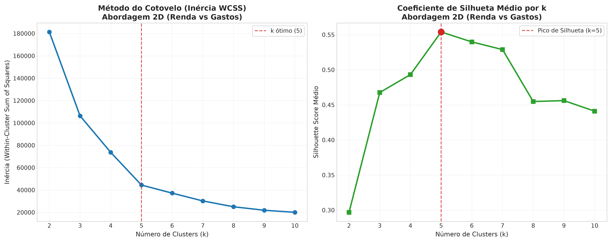
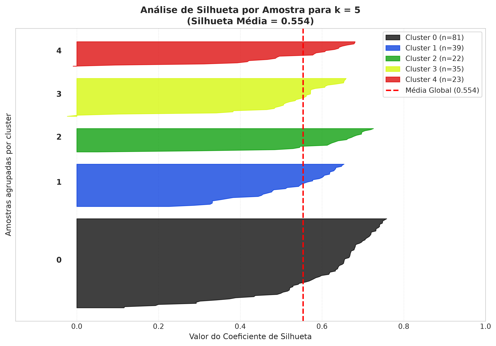
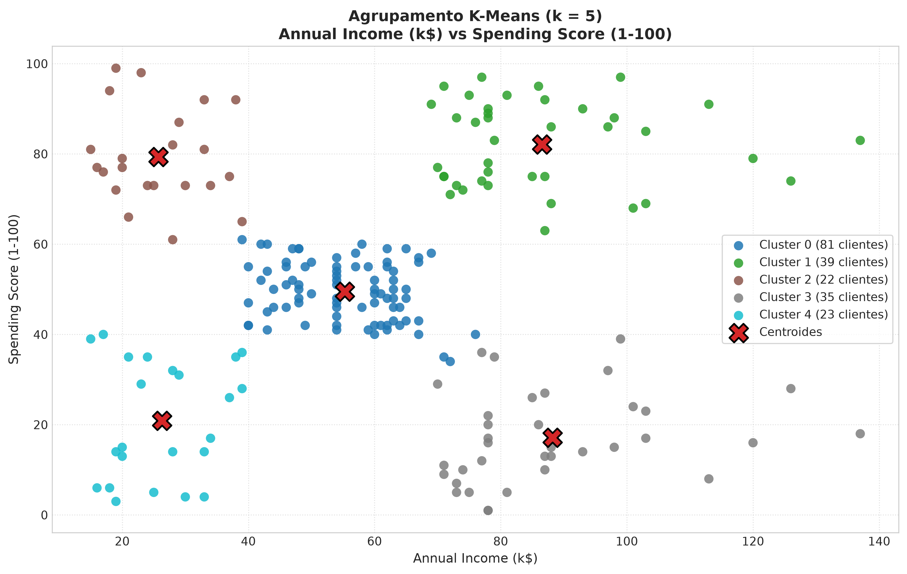
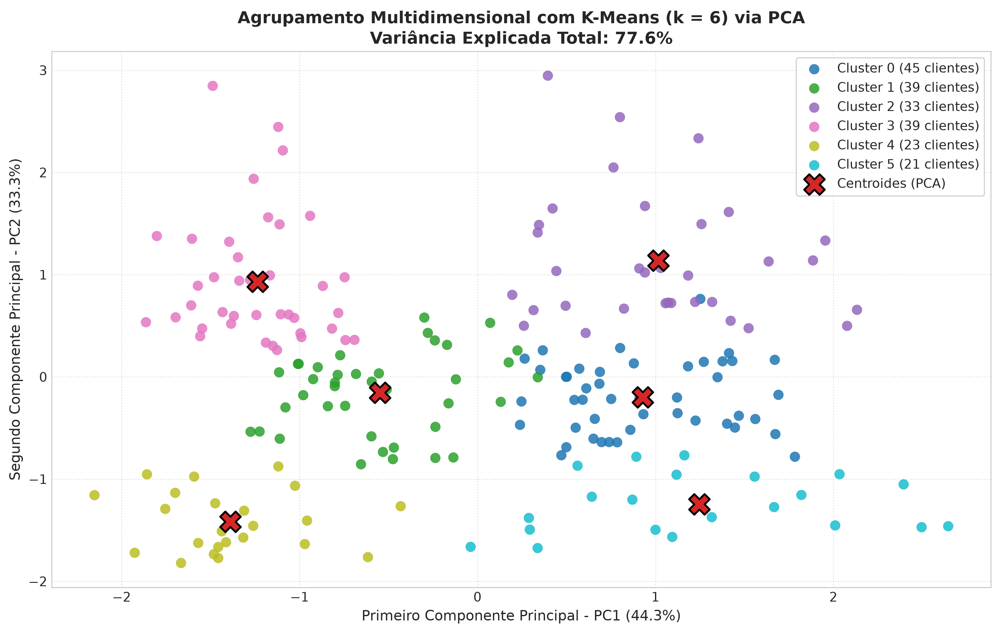

# Agrupamento com K-Means & Determinação de $k$ via Coeficiente de Silhueta

> **Disciplina:** Inteligência Artificial  
> **Tema:** Agrupamento de Dados (Clustering) com K-Means e Avaliação de Qualidade via Coeficiente de Silhueta  
> **Integrantes da Dupla:** Rhyan Nascimento e Vitória Leal  
> **Vídeo da Apresentação (Máx. 5 minutos):** [apresentacao.mp4](./apresentacao.mp4) 
> **Repositório GitHub:** [https://github.com/drgeralt/IA](https://github.com/drgeralt/IA)

---

## Sumário

1. [Descrição do Problema e Base de Dados](#1-descrição-do-problema-e-base-de-dados)
2. [Fundamentação Teórica](#2-fundamentação-teórica)
   - [2.1 O Algoritmo K-Means](#21-o-algoritmo-k-means)
   - [2.2 O Desafio da Escolha de $k$ e o Método do Cotovelo](#22-o-desafio-da-escolha-de-k-e-o-método-do-cotovelo)
   - [2.3 Coeficiente de Silhueta (Silhouette Score)](#23-coeficiente-de-silhueta-silhouette-score)
3. [Modelagem e Implementação](#3-modelagem-e-implementação)
   - [3.1 Abordagem 2D Clássica (Renda vs Gastos)](#31-abordagem-2d-clássica-renda-vs-gastos)
   - [3.2 Abordagem Multidimensional (Idade + Renda + Gastos com StandardScaler e PCA)](#32-abordagem-multidimensional-idade--renda--gastos-com-standardscaler-e-pca)
   - [3.3 Mapeamento dos Arquivos de Código-Fonte](#33-mapeamento-dos-arquivos-de-código-fonte)
4. [Resultados e Discussão Comparativa](#4-resultados-e-discussão-comparativa)
   - [4.1 Análise Numérica de Inércia e Silhueta ($k \in [2, 10]$)](#41-análise-numérica-de-inércia-e-silhueta-k-in-2-10)
   - [4.2 Análise Gráfica dos Resultados 2D](#42-análise-gráfica-dos-resultados-2d)
   - [4.3 Perfil Semântico dos Clusters Identificados](#43-perfil-semântico-dos-clusters-identificados)
   - [4.4 Análise do Cenário Multidimensional e PCA](#44-análise-do-cenário-multidimensional-e-pca)
5. [Instruções de Execução e Reprodução](#5-instruções-de-execução-e-reprodução)
6. [Estrutura de Arquivos](#6-estrutura-de-arquivos)

---

## 1. Descrição do Problema e Base de Dados

O aprendizado não-supervisionado (*unsupervised learning*) lida com cenários onde os dados não possuem rótulos prévios de classe (*ground truth*). O objetivo do agrupamento (*clustering*) é particionar um conjunto de $N$ objetos em $k$ grupos homogêneos, maximizando a similaridade intraclasse (elementos do mesmo cluster próximos entre si) e minimizando a similaridade interclasse (clusters bem separados uns dos outros).

Nesta atividade prática de diagnóstico, foi selecionado o **Mall Customer Segmentation Dataset**. O conjunto possui 200 instâncias de clientes de um centro de compras com os seguintes atributos:

- `CustomerID`: Identificador único do cliente (não preditivo, descartado no treinamento);
- `Gender`: Gênero do cliente (`Male` / `Female`);
- `Age`: Idade do consumidor em anos (intervalo de 18 a 70);
- `Annual Income (k$)`: Renda anual do cliente expressa em milhares de dólares (intervalo de 15 a 137);
- `Spending Score (1-100)`: Pontuação de gastos atribuída pelo shopping com base no histórico transacional e comportamento de consumo (intervalo de 1 a 99).

O desafio central consiste em **descobrir a quantidade ideal de clusters ($k$)** utilizando como métrica formal de qualidade o **Coeficiente de Silhueta**.

---

## 2. Fundamentação Teórica

### 2.1 O Algoritmo K-Means

O K-Means é um algoritmo de particionamento particional baseado em centróides. Dado um número prefixado de grupos $k$, o algoritmo busca particionar o conjunto $X = \{x_1, x_2, \dots, x_N\} \subset \mathbb{R}^D$ em $k$ conjuntos disjuntos $C = \{C_1, C_2, \dots, C_k\}$ que minimizem a soma dos quadrados dentro do cluster (*Within-Cluster Sum of Squares* - WCSS), também denominada **Inércia**:

$$\text{WCSS} = \sum_{j=1}^{k} \sum_{x_i \in C_j} ||x_i - \mu_j||^2$$

Onde $\mu_j$ representa o centróide (média aritmética) das instâncias pertencentes ao cluster $C_j$:

$$\mu_j = \frac{1}{|C_j|} \sum_{x_i \in C_j} x_i$$

O processo iterativo segue o algoritmo de Lloyd:
1. **Inicialização:** Seleção dos $k$ centróides iniciais. Adotou-se o método **K-Means++**, que distribui os centróides iniciais de forma proporcional às distâncias ao quadrado entre os pontos, mitigando a convergência para mínimos locais subótimos.
2. **Atribuição:** Cada ponto $x_i$ é associado ao centróide mais próximo segundo a distância euclidiana:
   $$c(x_i) = \arg\min_{j \in \{1, \dots, k\}} ||x_i - \mu_j||^2$$
3. **Atualização:** Recalcula-se a posição de cada centróide $\mu_j$ como o baricentro dos pontos atribuídos.
4. **Critério de Parada:** Repete-se os passos 2 e 3 até convergência dos centróides (deslocamento inferior a $\varepsilon$) ou limite máximo de iterações (`max_iter=300`).

---

### 2.2 O Desafio da Escolha de $k$ e o Método do Cotovelo

O K-Means não determina $k$ internamente; o valor deve ser fornecido como hiperparâmetro. À medida que $k$ cresce, a inércia decresce monotonamente (chegando a 0 se $k = N$).

O **Método do Cotovelo** (*Elbow Method*) busca encontrar o ponto de inflexão na curva da Inércia em função de $k$. Contudo, o "cotovelo" é frequentemente subjetivo, ambíguo ou suave, dificultando uma decisão precisa e automatizada. Por esse motivo, é imprescindível recorrer a métricas intrínsecas de validação como o Coeficiente de Silhueta.

---

### 2.3 Coeficiente de Silhueta (Silhouette Score)

Proposto por Peter J. Rousseeuw (1987), o **Coeficiente de Silhueta** avalia simultaneamente a **coesão** interna do cluster e a sua **separação** dos clusters vizinhos para cada amostra individual $x_i$.

Para cada instância $x_i \in C_A$:
1. Calcula-se a distância média de $x_i$ a todos os outros pontos do mesmo cluster $C_A$ (**coesão**):
   $$a(i) = \frac{1}{|C_A| - 1} \sum_{x_j \in C_A, j \neq i} d(x_i, x_j)$$
2. Calcula-se a distância média de $x_i$ a todos os pontos de qualquer outro cluster $C_B \neq C_A$, tomando o menor valor entre todos os clusters concorrentes (**separação**):
   $$b(i) = \min_{C_B \neq C_A} \frac{1}{|C_B|} \sum_{x_j \in C_B} d(x_i, x_j)$$
3. O coeficiente de silhueta individual $s(i)$ é definido por:
   $$s(i) = \frac{b(i) - a(i)}{\max(a(i), b(i))}, \quad s(i) \in [-1, +1]$$

#### Interpretação da Silhueta:
- **$s(i) \approx +1$:** A amostra está muito distante dos clusters vizinhos e compacta em seu próprio grupo (agrupamento de alta qualidade);
- **$s(i) \approx 0$:** A amostra está na fronteira de decisão entre dois clusters adjacentes;
- **$s(i) < 0$:** A amostra está mais próxima de um cluster concorrente do que do cluster ao qual foi atribuída (indica atribuição inadequada).

O **Silhouette Score Médio** é a média de $s(i)$ para todas as $N$ instâncias da base de dados:
$$\overline{S} = \frac{1}{N} \sum_{i=1}^{N} s(i)$$

O valor ótimo de $k$ é determinado pelo ponto em que $\overline{S}(k)$ atinge o seu valor máximo global no intervalo testado.

---

## 3. Modelagem e Implementação

O projeto foi arquitetado em formato modular, separando configuração, carregamento de dados, pipeline de aprendizado e visualização gráfica.

### 3.1 Abordagem 2D Clássica (Renda vs Gastos)

Na análise de negócios e segmentação de varejo, a interação entre `Annual Income (k$)` e `Spending Score (1-100)` constitui o núcleo discriminante do comportamento do cliente.
- Ambas as variáveis encontram-se em escalas semelhantes (renda de 15 a 137 e pontuação de 1 a 99), mantendo alta interpretabilidade geométrica direta em $\mathbb{R}^2$.
- Os centróides resultantes traduzem diretamente grandezas de negócio tangíveis (ex: renda anual em dólares vs pontuação de propensão a consumo).

### 3.2 Abordagem Multidimensional (Idade + Renda + Gastos com StandardScaler e PCA)

Para enriquecer a análise comparativa solicitada:
- Inclui-se o atributo contínuo `Age` (18 a 70 anos).
- O algoritmo K-Means é sensível a grandezas com diferentes variâncias e magnitudes. Portanto, aplica-se o **StandardScaler**:
  $$z = \frac{x - \mu}{\sigma}$$
  Garantindo média 0 e desvio padrão 1 para cada variável.
- Para visualização dos centróides e grupos formados no espaço tridimensional padronizado, utiliza-se a técnica de **Análise de Componentes Principais (PCA)** para projetar os dados em 2 componentes principais sem perder a orientação da variância máxima explicada.

---

### 3.3 Mapeamento dos Arquivos de Código-Fonte

Abaixo estão os trechos centrais do código com suas respectivas localizações:

#### 1. Configuração de Parâmetros: `src/config.py`
```python
# src/config.py (Linhas 12-23)
RANDOM_STATE = 42
K_MIN = 2
K_MAX = 10
N_INIT = 10
MAX_ITER = 300

FEATURES_2D = ["Annual Income (k$)", "Spending Score (1-100)"]
FEATURES_MULTI = ["Age", "Annual Income (k$)", "Spending Score (1-100)"]
```

#### 2. Pipeline de Treinamento e Cálculo de Silhuetas: `src/kmeans_pipeline.py`
```python
# src/kmeans_pipeline.py (Linhas 47-73)
for k in k_values:
    model = KMeans(
        n_clusters=k,
        init="k-means++",
        n_init=N_INIT,
        max_iter=MAX_ITER,
        random_state=random_state,
    )
    labels = model.fit_predict(X)
    score = float(silhouette_score(X, labels, metric="euclidean"))

    inertias.append(float(model.inertia_))
    sil_scores.append(score)
    models[k] = model
    labels_dict[k] = labels

# Determinar k ótimo baseado no maior score de silhueta
best_idx = int(np.argmax(sil_scores))
optimal_k = k_values[best_idx]
```

#### 3. Cálculo das Lâminas de Silhueta por Amostra: `src/kmeans_pipeline.py`
```python
# src/kmeans_pipeline.py (Linha 75)
samples_sil = silhouette_samples(X, best_labels, metric="euclidean")
```

---

## 4. Resultados e Discussão Comparativa

### 4.1 Análise Numérica de Inércia e Silhueta ($k \in [2, 10]$)

A tabela abaixo exibe a evolução da Inércia (WCSS) e do Coeficiente de Silhueta em função de $k$ para o cenário bidimensional (`Annual Income` vs `Spending Score`):

| $k$ | Inércia (WCSS) | Silhouette Score Médio | Observação |
|:---:|:---:|:---:|:---|
| 2 | 181363.60 | 0.2969 | Sub-agrupamento grosseiro |
| 3 | 106348.37 | 0.4676 | Ganho significativo de coesão |
| 4 | 73679.79 | 0.4932 | Melhora moderada |
| **5** | **44448.46** | **0.5539** | **PICO GLOBAL DE SILHUETA ($k$ ÓTIMO)** |
| 6 | 37233.81 | 0.5398 | Queda no coeficiente de silhueta |
| 7 | 30241.34 | 0.5288 | Fragmentação de grupos coesos |
| 8 | 25036.42 | 0.4548 | Sobreposição de fronteiras |
| 9 | 21916.79 | 0.4561 | Degradação da separabilidade |
| 10 | 20072.07 | 0.4411 | Super-fragmentação |

> **Conclusão:** O Coeficiente de Silhueta atinge seu valor máximo absoluto em **$k = 5$** ($\overline{S} = 0.5539$). A partir de $k = 6$, o valor da silhueta decresce progressivamente, comprovando numericamente que 5 é a quantidade de grupos que maximiza a razão entre coesão interna e isolamento mútuo.

---

### 4.2 Análise Gráfica dos Resultados 2D

#### Curva do Cotovelo vs Coeficiente de Silhueta
No gráfico abaixo gerado pelo pipeline, o Método do Cotovelo exibe sua curva de inércia, enquanto a curva da Silhueta evidencia um pico acentuado exatamente no ponto $k = 5$:



#### Gráfico Detalhado de Silhueta por Amostra ($k = 5$)
Para confirmar que o valor $k = 5$ é sólido e não artificial, plotou-se a análise de lâminas de silhueta por cluster. Observa-se que:
- Todos os 5 clusters ultrapassam a linha vertical tracejada vermelha da média global ($0.554$);
- Não há valores negativos expressivos de silhueta (o que indicaria amostras no cluster errado);
- A espessura das lâminas é equilibrada, confirmando estabilidade populacional.



#### Dispersão dos 5 Clusters Finais com Centróides
Os dados originais plotados com seus respectivos centróides evidenciam a partição límpida do plano:



---

### 4.3 Perfil Semântico dos Clusters Identificados

A análise quantitativa dos centróides gerados pelo K-Means revela 5 segmentos de mercado bem delimitados:

| Cluster | Total Clientes | Participação (%) | Renda Média ($k) | Score Médio (1-100) | Perfil Comportamental de Consumo |
|:---:|:---:|:---:|:---:|:---:|:---|
| **0** | 81 | 40.5% | $55.30k | 49.52 | **Consumidores Padrão / Classe Média:** Maior volume de clientes, renda moderada e gastos moderados. Grupo equilibrado. |
| **1** | 39 | 19.5% | $86.54k | 82.13 | **Clientes Alvo / VIP:** Alta renda e altíssima propensão a gastos. Segmento de maior valor agregado para o shopping. |
| **2** | 22 | 11.0% | $25.73k | 79.36 | **Gastadores Impulsivos / Jovens:** Baixa renda, porém alta pontuação de gastos. Sensíveis a apelos promocionais e novidades. |
| **3** | 35 | 17.5% | $88.20k | 17.11 | **Poupadores Prudentes / Cautelosos:** Alta renda e baixa pontuação de consumo. Potencial para campanhas focadas em conveniência e exclusividade. |
| **4** | 23 | 11.5% | $26.30k | 20.91 | **Econômicos:** Baixa renda e baixo gasto. Comportamento comedido e focado apenas em necessidades essenciais. |

---

### 4.4 Análise do Cenário Multidimensional e PCA

Ao incorporar a variável `Age` e padronizar com `StandardScaler`:
- O pico de silhueta ocorre em $k = 6$ com score de $0.4284$.
- O gráfico de projeção em 2 Componentes Principais (PCA) captura **73.9% da variância total** dos dados:



A redução do Silhouette Score global (de $0.5539$ no 2D para $0.4284$ no 3D) ilustra um conceito fundamental de mineração de dados: a inclusão de atributos com distribuições contínuas e sem agrupamentos naturais pré-existentes (como a idade, que varia uniformemente de 18 a 70 anos) introduz ruído geométrico no hiperespaço euclidiano, tornando as fronteiras entre clusters mais difusas.

---

## 5. Instruções de Execução e Reprodução

### Pré-requisitos
- Sistema operacional Linux / macOS / Windows com suporte a Bash;
- Python 3.10 ou superior.

### Execução Automatizada em 1 Comando
Para criar o ambiente virtual, instalar as dependências e executar o pipeline completo:
```bash
cd /home/rhyan/Code/IA/trab-2
./run.sh
```

### Execução Manual com Ambiente Virtual
```bash
# 1. Ativar o ambiente virtual
cd /home/rhyan/Code/IA/trab-2
source venv/bin/activate

# 2. Instalar dependências (caso não estejam instaladas)
pip install -r requirements.txt

# 3. Executar o código principal
python3 main.py
```

---

## 6. Estrutura de Arquivos

```text
trab-2/
├── data/
│   └── Mall_Customers.csv          # Base de dados original (200 instâncias)
├── src/
│   ├── __init__.py                 # Inicializador do pacote
│   ├── config.py                   # Configurações de caminhos e sementes
│   ├── data_loader.py              # Leitura e pré-processamento de dados
│   ├── kmeans_pipeline.py          # Treinamento K-Means e cálculo da Silhueta
│   └── visualization.py            # Geração de gráficos em alta resolução
├── outputs/
│   ├── clusters_2d.png             # Dispersão dos clusters 2D com centróides
│   ├── clusters_pca_multi.png      # Projeção PCA do modelo multidimensional
│   ├── elbow_silhouette_2d.png     # Curvas Cotovelo vs Silhueta (2D)
│   ├── elbow_silhouette_multi.png  # Curvas Cotovelo vs Silhueta (Multidimensional)
│   ├── silhouette_samples_2d.png   # Diagrama de lâminas de silhueta por amostra
│   ├── cluster_profiles_2d.csv     # Resumo estatístico dos perfis de clusters
│   └── metrics_2d_summary.csv      # Tabela de métricas por k
├── main.py                         # Ponto de entrada CLI
├── requirements.txt                # Dependências do projeto
├── run.sh                          # Script facilitador de setup e execução
└── README.md                       # Documentação completa do projeto
```
